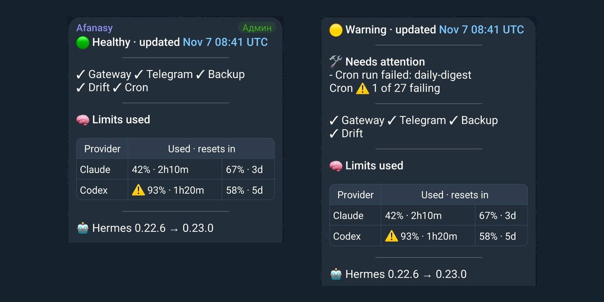
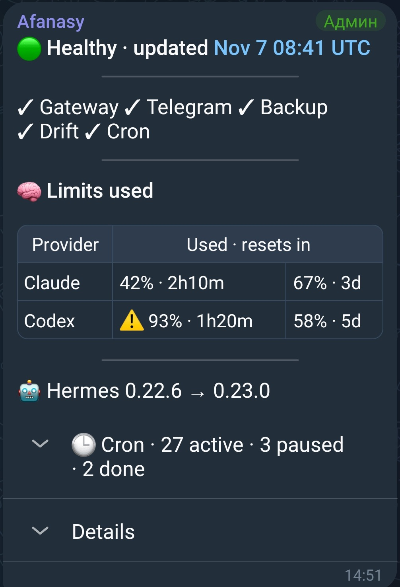
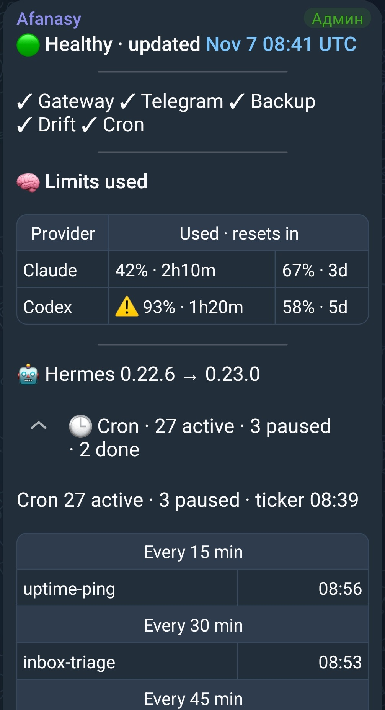
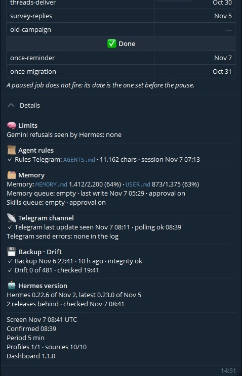
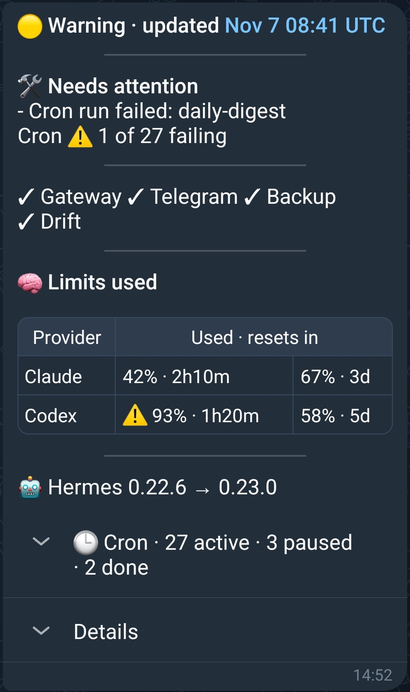
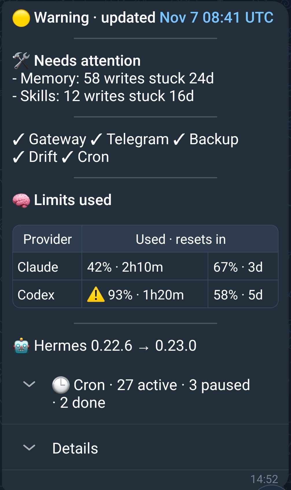
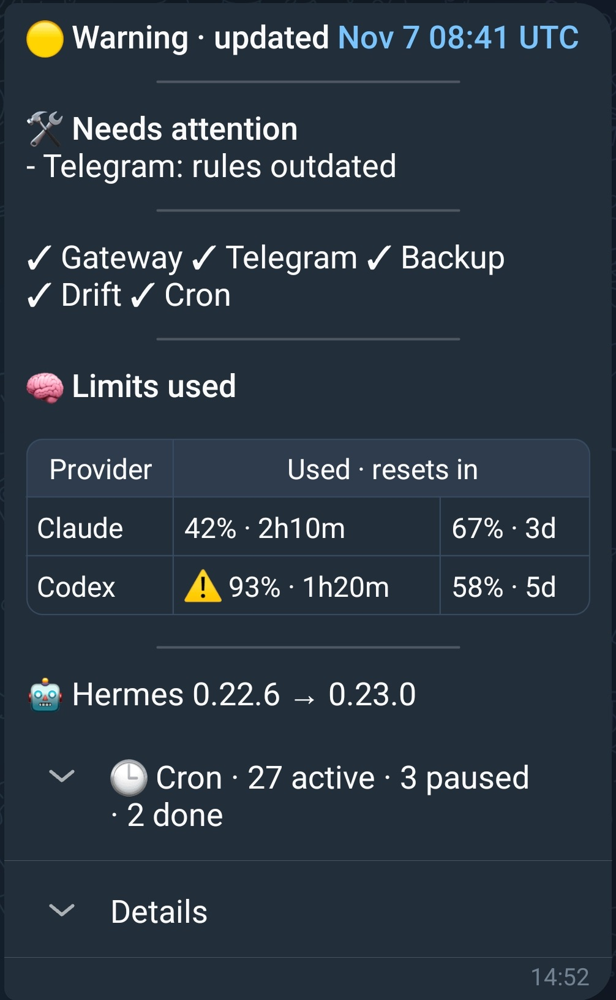

# hermes-agent-telegram-dashboard

**English** · [简体中文](README.zh-Hans.md)

[](https://github.com/bablobanov/hermes-agent-telegram-dashboard/actions/workflows/ci.yml)



*The rich view of 1.1.0. 1.1.1 sends the same screen as HTML text (see [Screenshots](#screenshots)).*

Read-only status dashboard for [Hermes Agent](https://github.com/NousResearch/hermes-agent) as one
pinned Telegram message, edited in place by a plugin inside the gateway. No Mini App, no LLM call,
nothing to press: the pinned bar shows the status line every time the chat is opened.

**The full documentation is the plugin's own README:
[`plugin/telegram_dashboard_probe/README.md`](plugin/telegram_dashboard_probe/README.md).** It says
how every line is read, what the plugin reads, writes and sends (its Disclosure section), the
settings, compatibility and the tests. The catalog page shows the same file.

## What the screen shows

- the status and when the data was read, in the top line the pinned bar carries
- one row of what works: the gateway, the Telegram channel (and whether it is deaf), the last
  backup, config drift, the cron ticker and its jobs
- up to five events that need attention, and what the screen could not check
- the account limits of each provider with the time to every reset (Claude and Codex through the
  Hermes usage facade, others from a local source of your own)
- the Hermes version the gateway runs against the latest upstream release
- folded, the details: whether the agent sees its rules, whether its memory keeps what it
  writes, the cron jobs and their failures, the reasons and the times

## Screenshots

Demo data, rendered by the plugin's own code at 1.1.0 and sent to a test topic; Telegram for Android,
the details on Telegram Desktop. These are the rich view of 1.1.0. 1.1.1 sends the same screen as
HTML text, the details in one collapsed quote and no table of the cron jobs: 1.1.0 sent the rich
view through a private call of the engine's Telegram adapter, which the catalog review asked to
remove, and it comes back once Hermes has a public way to send a pre-built rich message
([NousResearch/hermes-agent#151881](https://github.com/NousResearch/hermes-agent/issues/151881)).

| | | |
|---|---|---|
|  |  |  |
| A healthy installation | The cron jobs by how often they run | The details |
|  |  |  |
| A cron run failed three times in a row | Memory writes stuck waiting for approval | The rules changed after the session started |

## Install

Hermes 0.22.2 or newer. From the [Hermes Plugin Catalog](https://hermes-agent.nousresearch.com/docs/plugins/telegram_dashboard_probe),
which pins the reviewed commit:

```bash
hermes plugins install telegram_dashboard_probe
```

Or from a clone, one line puts the self-contained plugin folder in place:

```bash
git clone https://github.com/bablobanov/hermes-agent-telegram-dashboard.git && cd hermes-agent-telegram-dashboard && install -d "${HERMES_HOME:-$HOME/.hermes}/plugins" && cp -r plugin/telegram_dashboard_probe "${HERMES_HOME:-$HOME/.hermes}/plugins/"
```

Then enable it in `config.yaml` (`plugins.enabled` and the `chat_id` setting), restart the gateway
and pin the message it sends. Nothing is installed into the engine's environment; `SHA256SUMS`
lists every file of the plugin folder (`sha256sum -c SHA256SUMS` from `plugin/`). The settings
("Deploying on a gateway") and what to do after an update from 1.0.0 (restart the gateway once)
are in the plugin's README.

## In short, before you install

- reads Hermes' own files without changing them, and the agent's context files wherever its
  working directory is; writes only its own record through the engine's plugin state
- sends and edits the one message through the engine's Telegram adapter; the plugin never reads
  the bot token
- asks the Hermes usage facade for Claude and Codex limits every 5 minutes by default; to answer,
  Hermes may read the Claude Code or Codex CLI login on the host and refresh and save its OAuth
  token
- asks GitHub for the latest Hermes release without a token at most once per 15 minutes
- touches some engine internals by name and keeps a registry of its own in `sys.modules`; the
  full list is the [Disclosure](plugin/telegram_dashboard_probe/README.md#disclosure-what-the-plugin-reads-writes-and-sends)
  section

## License

MIT.
