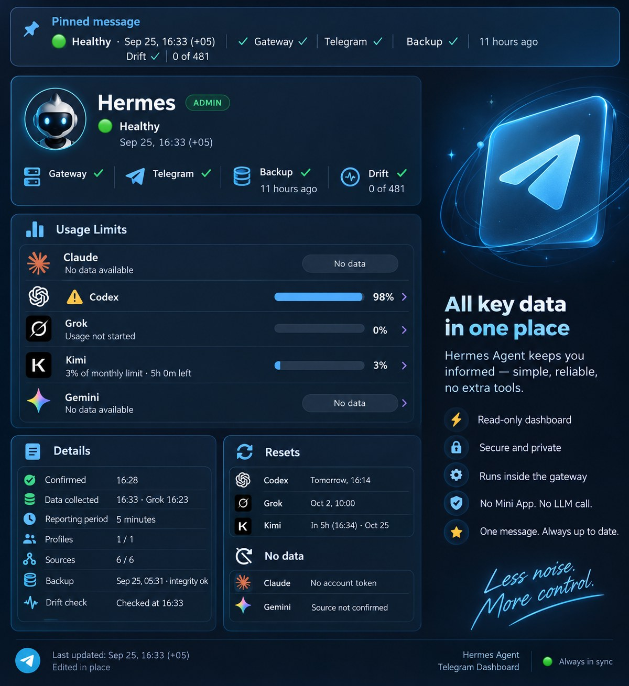

# hermes-agent-telegram-dashboard

[English](README.md) · **简体中文**

> 本文译自英文 [README.md](https://github.com/bablobanov/hermes-agent-telegram-dashboard/blob/8da68c4e19eb976336ccf667629e6ac386943852/README.md)（提交 `8da68c4e19`）。如有出入，以英文版为准；英文版更新后，本译文可能滞后。
>
> 这是精简版译文。完整说明（插件的内部工作方式、消息中每一行的细节、额度、看门狗 `watchdog/dashboard_probe_check.py`、兜底 tick、测试）见英文版 [README.md](README.md)。

[](https://github.com/bablobanov/hermes-agent-telegram-dashboard/actions/workflows/ci.yml)


[Hermes Agent](https://github.com/NousResearch/hermes-agent) 的只读状态面板：形式是一条 Telegram 置顶消息，按固定周期原地编辑更新。不需要 Mini App，也不调用 LLM。

负责更新的程序**以插件形式运行在网关内部**（`plugin/`）：机器人 token 从不离开引擎，消息通过引擎自己的 Telegram 适配器编辑。对于没有插件 API 的安装环境，保留了一个使用独立机器人的 cron tick（`python -m telegram_dashboard`）作为兜底方案。

## 安装

本插件以其 manifest 名称收录在 [Hermes Plugin Catalog](https://hermes-agent.nousresearch.com/docs/plugins/telegram_dashboard_probe)（Hermes 插件目录）中。目录锁定了经过审核的提交，安装时会把正是这个提交检出到网关的插件目录：

```bash
hermes plugins install telegram_dashboard_probe
```

插件文件夹 `plugin/telegram_dashboard_probe/` 是自包含的：`telegram_dashboard` 包就在它里面（下文出现的模块路径，例如 `telegram_dashboard/grok.py`，都是相对于这个文件夹而言）。不使用插件目录的话，从克隆的仓库用一行命令就能把文件夹放到位：

```bash
git clone https://github.com/bablobanov/hermes-agent-telegram-dashboard.git && cd hermes-agent-telegram-dashboard && install -d "${HERMES_HOME:-$HOME/.hermes}/plugins" && cp -r plugin/telegram_dashboard_probe "${HERMES_HOME:-$HOME/.hermes}/plugins/"
```

无论用哪种方式，之后都要在 `config.yaml` 中启用它（`plugins.enabled` 和 `chat_id` 设置；见英文版 [The plugin: the screen inside the gateway](README.md#the-plugin-the-screen-inside-the-gateway) 一节中 “Deploying on a gateway” 下的表格），重启网关，再把它发出的消息置顶。不会往引擎的运行环境里安装任何东西；仓库根目录的 `SHA256SUMS` 列出了插件文件夹中的每个文件，因此在 `plugin/` 目录（或网关的 `plugins/` 目录）下运行 `sha256sum -c SHA256SUMS` 即可校验副本。

## 消息里显示什么

面板就是一条置顶的文本消息，位于智能体的私聊中，或其群组的某个话题里。网关内的插件每隔几分钟通过引擎自己的 Telegram 适配器原地编辑这条消息，因此聊天顶部的置顶消息栏始终显示当前的状态行，消息正文则承载其余内容。读者这一侧不用打开什么，也不用安装什么，没有第二个机器人，也不调用 LLM：每次打开聊天，它都在那里。

正文约为一屏手机的长度，每行约 30 个字符，后面跟着一个 Telegram 默认折叠显示的详情区块。宽度只是参考，不是硬性规定：手机使用比例字体，同样字数的一行会不会折行，取决于具体内容（emoji 或西里尔字母比拉丁字母宽）。

```
🟢 Healthy · Sep 25 12:21 +05       status and the dated data stamp (the pinned header shows it)
Gateway ✓ · Telegram ✓              words when something is off: stopped, disconnected;
                                    ⚠️ no sends / stalled / quiet: connected but deaf
Backup ✓ 6 h ago                    the last state.db backup; ⚠️ when it failed or is older than 26 h
Drift ✓ 0 of 481                    keys that differ from the approved baseline
Cron ✓ 27 jobs                      active jobs; ⚠️ N of M failing, ticker silent, ticks failing

🧠 Limits used
Claude · no data                    a line without a number never shows a zero
⚠️ Codex 98% (1h21m)                the spent share, the time to the reset; the mark from 90%
Grok · usage not started            a state in words is never turned into a number
Kimi 3% (29d)                       every window, in the provider's own order
Gemini · no data                    no number without billing; ⚠️ hit limit for an hour after one

🤖 Hermes 0.21.3 → 0.21.5           the version the gateway runs → the latest upstream release;
                                    🆕 and its age for a day after a release came out

▎Details                            collapsed, a blank line between the sources: confirmation
▎…                                  time, the odd data minute, period, coverage; the channel's
                                    times; absolute backup time and integrity, drift check time,
                                    the cron failures; whether each platform's agent sees its
                                    rules; the memory notebooks and the approval queue; the
                                    plans, logins and Gemini refusals; release dates; the reason
                                    of every "no data"; the dashboard's own version last
```



图片只是示意消息包含哪些内容；消息本身就是上面的纯文本。

各行的含义：

- **状态行**：整体状态，加上带日期的数据时间戳；置顶消息栏显示的就是这一行。
- **Gateway / Telegram**：网关和 Telegram 适配器是否在运行；出问题时直接用文字写明（已停止、已断开）。适配器显示已连接、实际却“聋了”（发不出消息、轮询停滞、太久收不到更新）时，会带上 ⚠️ 标记。
- **Backup**：最近一次 `state.db` 备份距今多久；备份失败或已超过 26 小时则显示 ⚠️。
- **Drift**：与已批准基线不一致的配置键数量。
- **Cron**：活跃任务数；有任务失败、ticker 没有心跳或每次 tick 都出错时显示 ⚠️。
- **🧠 Limits used（已用额度）**：每个提供商一行，显示已用比例和距离重置的时间，按提供商自己的顺序列出它报告的每个窗口；任一窗口用量达到 90% 起加 ⚠️。没有数字的行绝不显示 0，提供商用文字报告的状态（例如 `Grok · usage not started`）也绝不换算成数字。Gemini 在未开通计费时没有数字，被拒绝调用后的一小时内显示 ⚠️。
- **🤖 Hermes**：网关正在运行的版本 → 上游最新发布的版本；新版本发布后的一天内带有 🆕 和发布至今的时长。
- **Details（详情）**：折叠显示，不同来源之间空一行：确认时间、读取时间与主屏不同的数据、周期、覆盖率；通道的各项时间；备份的绝对时间和完整性、漂移检查时间、cron 失败明细；每个平台的智能体是否看到了自己的规则；记忆笔记本和审批队列；套餐、登录状态和 Gemini 拒绝记录；发布日期；每个 “no data” 的原因；最后是面板自身的版本号（`Dashboard 0.11.0`），方便一眼认出安装的是哪个版本。

顶部区块之后、额度之前，最多显示五条需要关注的事件。额度的来源：Claude 和 Codex 来自 Hermes 的用量接口（usage facade），Grok 的每周额度池来自 xAI 为自家 Grok CLI 提供的接口，Kimi Code 的各个窗口来自 Kimi Code 平台为自家客户端提供的接口，任何提供商也都可以由你自己的本地进程提供。Gemini 没有计费就没有数字，但也绝不显示 0：Google 最近一次拒绝引擎调用的时间，近期内会显示在它那一行，并且始终保留在详情里。

无法证明某个值的数据源显示 `unknown`，当前安装中不存在的数据源显示 `unsupported`。两者都会降低覆盖率，都不会变绿（唯一的例外是 cron 运行历史，详见英文版）。覆盖率本身（`Profiles 1/1 · sources 10/10`）放在详情里，只有不完整时才会出现在主屏上。

## 新鲜度是硬性要求

更新程序死掉的置顶面板，看起来和一切正常的系统一模一样，所以消息里始终带有数据的绝对时间和最后一次 Telegram 确认的时间；连续两个周期未确认，第一行就会出现醒目的横幅；`python -m telegram_dashboard --config c.json --check` 供外部看门狗检查消息新鲜度，退出码 0 表示已确认（confirmed），1 表示滞后（lagging），2 表示过期、丢失或从未确认（stale、lost、never）。检查读取的是实际负责投递的那条路径的记录：插件读 `plugin_state_path`，否则读 cron tick 的 `state_path`；两条路径从不写同一个文件，检查指向错误的文件时会报告 `never`。Telegram 返回的 `message is not modified` 视为确认而不是失败；消息丢失时，会以 ERROR 级别记入日志、写入记录、重建一次，并在新消息中说明。

## 跨 Hermes 版本的兼容性

面板探测的是能力，而不是版本号；版本行只显示版本号，不据此做任何判断。`telegram_dashboard/compat_matrix.json` 按数据源记录了探测方式以及在哪些版本上验证过。遇到新版本时，覆盖率会下降并指出缺了什么，而不是直接坏掉。

“已验证”具体指什么（完整说明见英文版表格）：

| Hermes | 验证方式 |
|---|---|
| 0.21.1 (`2237be3559`) | 插件路径在真实的引擎对象上执行（`tests/test_probe_plugin.py`），并自 2026-09-11 起在一台在线网关上持续试运行 |
| 0.21.3 (`v2026.9.14`) | 升级后的试运行网关：自 2026-09-25 起，插件在该网关上通过 `_edit_text` 以 HTML 形式编辑置顶消息；Kimi 凭据解析器、cron 文件、上下文文件等数据源涉及的引擎接口在引擎源码中核对过 |
| 0.21.5 (`v2026.9.24`) | 在引擎源码中核对 `_edit_text` 和 `edit_message`：签名和实现与 0.21.1、0.21.3 相同 |
| 0.21.6 (`v0.21.6`, 2026-10-08) | 在 0.21.6 要求的 Python 3.14.6 上，针对已安装的引擎运行完整测试套件；`hermes plugins validate`：`ok: true`，无警告；逐个数据源对照 0.21.5 核对了引擎接口：相同或兼容，只有三处改为按 0.21.6 的方式读取（用引擎自己的 YAML 解析器读配置、版本号不再来自常量、上下文文件的 BOM）；插件由引擎自己的插件发现机制以默认的进程内模式加载，在 `plugins.isolation: host` 下被拒绝（见下文） |
| main (`485979ddf4`, 2026-09-28) | 在引擎源码中核对 `edit_message` 和 `_edit_text`：签名不变，公开方法仍不接受 parse mode |
| main (`6ec05205a9`, 2026-09-30) | 在引擎源码中核对 cron 文件、运行历史的结构和适配器的流量计数器：字段和属性与 0.21.3 相同 |
| 0.20.5 | 读过一个桌面版安装的源码：数据源会降级，插件 API 不存在（见下文的最低版本） |

其余版本均未验证。在这些版本之上，数据源在运行时探测，不支持的降级为 `unsupported`；本文不承诺“适用于所有版本”。

**投递的最低版本是 Hermes 0.21.1。** 插件路径依赖 `PluginContext.register_platform_handler` 和适配器的 `_wire_plugin_handlers`，而 0.20.x 中两者都不存在。在 0.20.x 上插件不会加载处理器，什么也不会投递；唯一可用的是带独立机器人 token 的兜底 cron tick。兼容原则仍适用于各个*数据源*（网关状态、额度、配置漂移会按版本降级），但不适用于投递。

**只能在进程内运行。** Hermes 0.21.6 新增了 `plugins.isolation`。默认值 `in_process` 像以前一样把插件加载进网关。设为 `plugins.isolation: host` 时，引擎会在单独的宿主进程中运行第三方插件，并在那里拒绝投递所依赖的那个调用 `register_platform_handler`：插件不会加载，引擎也会明确报出原因。插件这一侧无法解决这个问题：消息要通过在线的 Telegram 适配器编辑，而适配器留在网关里。`host` 模式下的网关只能使用带独立机器人 token 的兜底 cron tick。

三条禁令，来自一个前身项目因此失败的教训：不导入引擎**内部**模块，不替换核心文件，不使用 post-merge 钩子或 `assume-unchanged`。一个明确的例外：账号额度来自 `agent.account_usage.fetch_account_usage`，这是一个在所有已验证版本上签名都相同的公开函数，调用方式与网关自带的 `/usage` 完全一致；导入失败时，该数据源记为 `unsupported`。

本精简译文没有收录、但英文版逐一写明的引擎接触点：

- Grok 和 Kimi 的凭据由引擎自己的认证代码解析（`hermes_cli.auth_xai.resolve_xai_oauth_runtime_credentials`、`hermes_cli.auth.resolve_api_key_provider_credentials`），其行为与 Hermes 的任何请求相同：快过期的 Grok token 会在 xAI 的 token 端点刷新并保存到 `auth.json`，xAI 永久拒绝刷新时会清掉那里失效的 token；`.env` 和网关环境中都没有可用的 Kimi key 时，解析函数会加载 Hermes 的凭据池，池有变化时会写回 `auth.json`。插件自己的代码不写 `auth.json`。见英文版 [Limits: three kinds that never mix](README.md#limits-three-kinds-that-never-mix)。
- 插件还以只读方式使用引擎的几个私有名称，只当作能力来探测，不当作承诺：适配器的 `_edit_text`（HTML 形式的消息）和 Telegram 行用到的四个轮询属性、`agent.prompt_builder._read_text_with_timeout` 的签名（从不调用）、`hermes_cli.version_info._cached_version_info`（不调用也不修改其中任何东西）。见英文版 [Connected but deaf: the Telegram line](README.md#connected-but-deaf-the-telegram-line)、[The rules line](README.md#the-rules-line-does-the-agent-see-its-context-files) 和 [The Hermes version line](README.md#the-hermes-version-line)。

## 更多内容

以下章节只有英文版，本译文未收录：

- [The plugin: the screen inside the gateway](README.md#the-plugin-the-screen-inside-the-gateway)：插件在网关内的工作流程、HTML 与纯文本两种消息形式、在网关上部署的步骤和全部设置项
  - [The cron line](README.md#the-cron-line)：cron 行的数据来源和失败判定规则
  - [Connected but deaf: the Telegram line](README.md#connected-but-deaf-the-telegram-line)：Telegram 行，如何判断适配器已连接却收不到更新、发不出消息
  - [The rules line: does the agent see its context files](README.md#the-rules-line-does-the-agent-see-its-context-files)：规则行，智能体是否真正加载了自己的上下文文件（`AGENTS.md` 等）
  - [The memory section: does the agent keep what it writes](README.md#the-memory-section-does-the-agent-keep-what-it-writes)：记忆部分，记忆笔记本的用量和等待审批的写入队列
  - [The backup line](README.md#the-backup-line)：备份行和备份状态文件的格式
  - [The Hermes version line](README.md#the-hermes-version-line)：Hermes 版本行，如何确定正在运行的版本和上游最新版本
  - [Limits: three kinds that never mix](README.md#limits-three-kinds-that-never-mix)：额度的三种类型（官方配额、本地统计、无数据），以及 Grok、Kimi、Codex、Claude 的读取方式
  - [External limit sources](README.md#external-limit-sources)：外部额度来源，由你自己的本地进程提供额度数据
  - [Gemini refusals from the engine log](README.md#gemini-refusals-from-the-engine-log)：从引擎日志读取 Gemini 的拒绝记录
  - [The watchdog: `watchdog/dashboard_probe_check.py`](README.md#the-watchdog-watchdogdashboard_probe_checkpy)：看门狗，在插件之外检查消息新鲜度的 cron 任务
- [Running the fallback tick](README.md#running-the-fallback-tick)：运行兜底 tick 的命令和 JSON 配置
- [Tests](README.md#tests)：测试的运行方式，以及测试中固定下来的不变量
- [License](README.md#license)：许可证（MIT）
